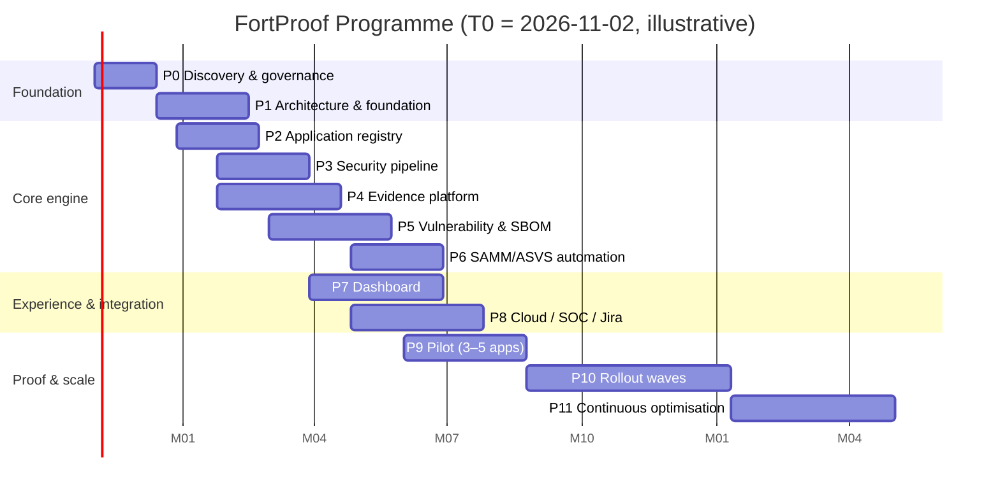

# Roadmap

| | |
|---|---|
| Status | PROPOSED. Durations assume the Phase 2+ team in the [charter section 16](../charter/programme-charter.md#16-resource-requirements-indicative-to-be-refined-in-the-business-case) and that external dependencies land on time (R-06). |
| Start (T0) | Charter approval date (TBC) |

## Phases

| Phase | Goal | Key outputs | Exit gate |
|---|---|---|---|
| **0 Discovery and governance** | Know the estate. Get decisions and dependencies moving. | Inventory, validated assumptions, Board running, catalogue/model decisions, external requests dated, buy-vs-build decision, pilot teams | [PID section 3](../charter/project-initiation-document.md#3-phase-0-discovery-and-governance-6-weeks) |
| **1 Architecture and foundation** | Prove the riskiest part (verified pull-based evidence) on a thin slice | IaC, auth, data layer, config loader, GitHub App + receiver, thin slice | [PID section 4](../charter/project-initiation-document.md#4-phase-1-architecture-and-foundation-810-weeks) |
| **2 Application registry** | Authoritative apps, owners, tiers | Registry API, `application.yaml` ingestion, classification workflow, onboarding CLI/PR | 100% of pilot apps registered and classified with approved tiers |
| **3 Security pipeline** | Paved road v1 | `security-workflows` v1.0 (suite, SAST, SCA, IaC, container, SBOM, workflow-lint, dependency review, emit-evidence), migration of infra-repo workflows, DD/DT keys removed from pilot repos | Canary repos green. Manifests schema-valid. Pinned release registered. |
| **4 Evidence platform** | Evidence in, controls out | Ingestion + verification, WORM, hash chain + checkpoints, freshness engine, evaluator framework + 20 automated evaluators, control-state API | AC-01/02/05 pass. Freshness transitions verified. Integrity job green 14 days. |
| **5 Vulnerability / SBOM** | Contextual findings and CVE query | DD/DT connectors, finding projection + fingerprints, risk engine v1, EPSS/KEV feeds, CVE impact query, licence evaluation | CVE query < 15 min (target < 1 min). Dedup verified across 10 consecutive runs. |
| **6 SAMM/ASVS automation** | Evidence-derived maturity | SAMM import, maturity calculation + snapshots, ASVS import + applicability + requirement status, manual assessment workflow | Pilot apps have explainable maturity with provenance |
| **7 Dashboard** | Role-based views | Engineer, team, owner, business unit, leadership, executive views. Drill-down to evidence. | Usability test with 5 users per persona |
| **8 Cloud / SOC / Jira** | Close the loop | Jira create/sync/close-by-evidence, Defender/Security Hub, Sentinel events + analytics rules | Ticket dedup + reopen-on-fail demonstrated. SOC signs off the event catalogue. |
| **9 Pilot** | End-to-end proof on real apps | Pilot report, survey, tuned catalogue, platform pen test | [Pilot criteria](#pilot-phase-9) met |
| **10 Rollout** | Scale by tier | Waves: Tier 1 → Tier 2 → Tier 3/4 self-service. Gates enabled per wave. | Charter exit criteria trending |
| **11 Optimisation** | Improve signal and automation | SSVC evaluation, VEX, package proxy, OpenSSF Scorecard input, LMS connector, further automation of manual controls | Continuous |

## 30 / 60 / 90 days (from T0)

| Horizon | Outcomes |
|---|---|
| **30 days** | Charter signed. Board ToR agreed, first meeting held. GitHub estate inventory complete (repos, languages, GHAS enablement, Actions usage). Assumptions A-01…A-08 validated or changed. External configuration requests raised with owners/dates. Pilot candidates shortlisted. Catalogue v0.1 walkthrough with AppSec and 2 champions. DPIA started. |
| **60 days** | Build-vs-buy decision recorded. Catalogue v0.2, tier model, risk model and SLAs approved (or amended) by the Board. Pilot teams committed. Phase 1 started: dev environment IaC applied, Entra auth working, schema migrated with security tests in CI, catalogue loader live. DD/DT hardening plan agreed with the infra-repo owners. |
| **90 days** | **Thin slice live:** a real repo's CodeQL run → verified evidence → ASC-BLD-01 state visible via API with an evidence chain. GitHub App (reader) installed. Webhook receiver in prod-like env. Platform repo onboarded to itself. Abuse cases AC-01/02/05/06 automated. Phase 1 gate review. |

## 6 / 12 / 18 months

| Horizon | Outcomes |
|---|---|
| **6 months** | Registry live for pilot business units. `security-workflows` v1 released and pinned in pilot repos. Evidence engine with ~20 automated controls. DD/DT integrated via the platform (no repo-held keys in pilot repos). Risk engine v1 with EPSS/KEV. CVE impact query working. First evidence-derived maturity for pilot apps (baseline). |
| **12 months** | Pilot complete and signed off. Tier 1 wave onboarded. Jira closure-by-evidence in use. Sentinel events live. Dashboards for all personas. Platform pen tested. KPIs reported monthly from the platform. O2 (≥ 90% Tier 1/2 current evidence) on track. |
| **18 months** | Tier 2 complete. Tier 3/4 self-service onboarding open. Gates enabled for Tier 1/2 per [pipeline gating roadmap](../../../docs/architecture/05-pipeline-architecture.md#9-gating-roadmap-observe--gate). Second annual SAMM cycle shows a measured trend with provenance. Catalogue v1.x reviewed. Programme moving to BAU per charter exit criteria. |

## 18-month maturity roadmap (targets PROPOSED; organisation level, evidence-backed)

| SAMM practice | Baseline (expected) | 6 mo | 12 mo | 18 mo | Main levers |
|---|---|---|---|---|---|
| Strategy & Metrics | ~0.5 | 1.0 | 1.5 | 2.0 | Charter, KPI catalogue, platform reporting |
| Policy & Compliance | ~0.5 | 1.0 | 1.5 | 2.0 | Standards + machine-testable catalogue |
| Education & Guidance | ~0.5 | 0.75 | 1.5 | 2.0 | Champions programme, role training |
| Threat Assessment | ~0.25 | 0.75 | 1.5 | 2.0 | Classification for all apps, threat-model kit |
| Security Requirements | ~0.25 | 0.5 | 1.25 | 1.75 | ASVS profiles, tagged tests |
| Secure Architecture | ~0.5 | 0.75 | 1.0 | 1.5 | Reference architectures, EOL tracking |
| Secure Build | ~1.0 | 1.5 | 2.25 | 2.5 | Paved-road pipeline, SBOM, provenance |
| Secure Deployment | ~0.75 | 1.25 | 2.0 | 2.25 | OIDC, environment protection, deploy verification |
| Defect Management | ~0.5 | 1.25 | 2.0 | 2.5 | Risk engine, SLA, Jira, RCA |
| Architecture Assessment | ~0.25 | 0.5 | 1.0 | 1.5 | Review service |
| Requirements-driven Testing | ~0.25 | 0.5 | 1.0 | 1.5 | ASVS-tagged tests, abuse cases |
| Security Testing | ~0.75 | 1.25 | 1.75 | 2.25 | CodeQL everywhere, DAST/API, pen tests |
| Incident Management | ~0.75 | 1.0 | 1.5 | 1.75 | SIEM log health, app runbooks |
| Environment Management | ~0.75 | 1.0 | 1.75 | 2.0 | Cloud posture attribution, image patching |
| Operational Management | ~0.25 | 0.5 | 1.0 | 1.25 | Data-store declaration, decommissioning |

Baselines are placeholders until the Phase 0/6 assessment. **Targets are about direction and pace, not a promise.** The platform shows the evidence mix behind every value.

## Pilot (Phase 9)

### Pilot cohort (selected in Phase 0)

| Slot | Profile | Exercises |
|---|---|---|
| A | Tier 1, internet-facing citizen service, containerised, API + web | Full control set, DAST/API, threat model facilitation, architecture review, Jira |
| B | Tier 2 internal service on Azure PaaS with Terraform | IaC, cloud posture attribution, OIDC deploy |
| C | IaC-heavy platform repo (e.g. a Terraform policy-as-code repository) | Terraform SBOM parser, Checkov, migration from infra-repo workflows |
| D | npm/CDK (e.g. AWS Landing Zone Accelerator) | npm SBOM, Security Hub, AWS federation |
| E (optional) | Public open-source repo | Public-evidence suppression, fork PR handling |

### Pilot must demonstrate (all 19 brief items)

Repository onboarding → registration → classification → baseline generation (required controls per tier) → GitHub security workflows → SAST → SCA → secrets → IaC → container → SBOM → evidence ingestion → vulnerability normalisation → risk calculation → Jira ticket → remediation → revalidation (re-scan closes finding and ticket) → SAMM maturity calculation → dashboard reporting.

### Success criteria (measurable)

| # | Criterion | Target |
|---|---|---|
| PS-1 | Pilot apps registered with resolvable owners and approved tier | 100% |
| PS-2 | Onboarding effort per repo (caller workflow + application.yaml) | ≤ 2 engineer-hours median |
| PS-3 | Mandatory automated controls with a computed state (not `error`) | 100% |
| PS-4 | Evidence verification: forged/unpinned evidence attempts rejected (red-team exercise) | 100% rejected |
| PS-5 | Ingestion latency p95 | < 10 min |
| PS-6 | Finding dedup: duplicate findings/tickets created across 10 consecutive pipeline runs | 0 |
| PS-7 | Closure by evidence: tickets closed only after a verifying re-scan | 100%. Reopen-on-fail demonstrated. |
| PS-8 | CVE impact query for a seeded CVE returns affected / possibly affected / not affected correctly | 100% vs ground truth |
| PS-9 | Calibration: AppSec manual check of 30 sampled SATISFIED control states agrees | ≥ 97% |
| PS-10 | Every maturity score drillable to control states and evidence | 100% |
| PS-11 | Pipeline overhead on PR (p90 added duration) | ≤ 10 min |
| PS-12 | Pilot team satisfaction (clarity, noise, effort) | ≥ 70% positive |
| PS-13 | Platform pen test | No open high/critical |
| PS-14 | No platform credentials in pilot repos (DD/DT keys removed and rotated) | 0 remaining |
