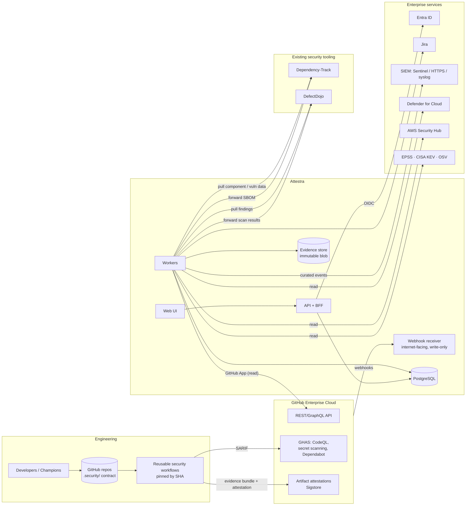
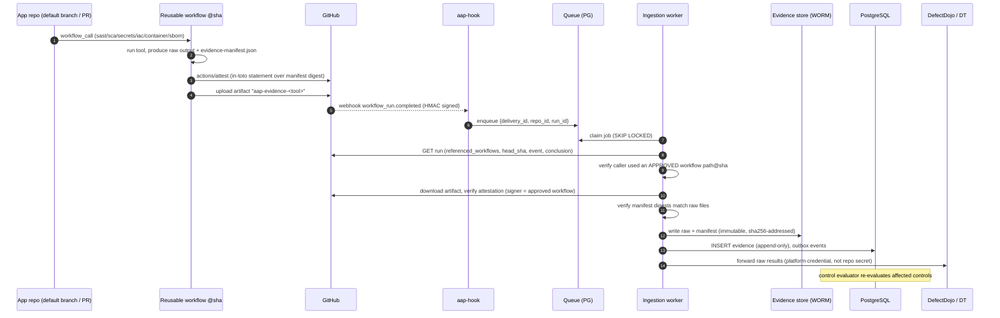
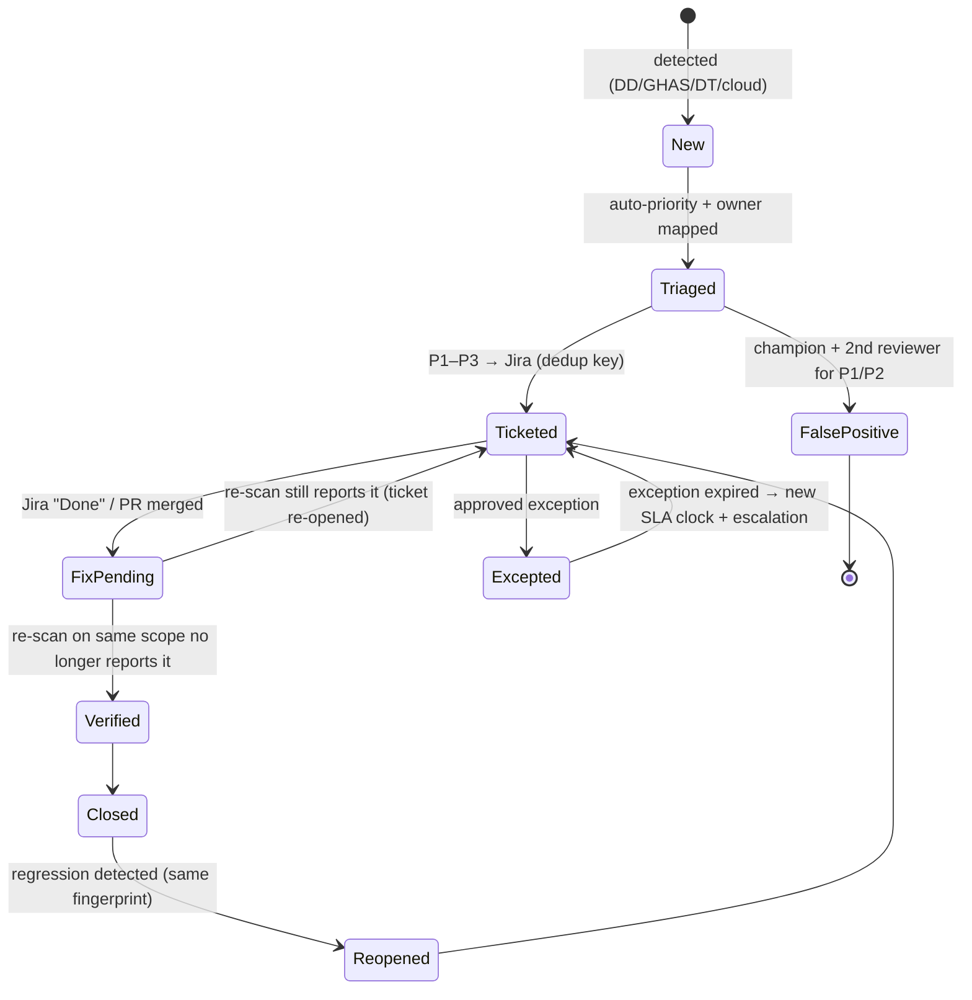

# 02 — Platform Architecture

| | |
|---|---|
| Status | IMPLEMENTED (C1–C13) |
| Related ADRs | 001, 004–008, 014, 018–020, 022–025, 027 |

## 1. Architectural stance

The platform is an **assurance layer**. It does not replace the security tools the organisation already owns or has scaffolded. It adds what none of them has: **application context, a control model, an evidence ledger, a risk engine and maturity derivation**.

| Concern | System of record | Why |
|---|---|---|
| Source, workflow runs, GHAS alerts (CodeQL, secret scanning, Dependabot), repo settings | **GitHub** | Authoritative and already licensed. We read; we do not copy the logic. |
| SBOM component inventory and continuous CVE matching | **Dependency-Track** | Re-scores existing SBOMs as new CVEs land, without re-running CI. Infra ADR-0001. |
| Scanner output normalisation and cross-tool dedup (200+ parsers) | **DefectDojo** | Writing parsers is undifferentiated work. |
| Cloud posture findings | **Defender for Cloud / AWS Security Hub** | Authoritative per cloud. |
| Security events and incidents | **Your SIEM**: Sentinel, or any SIEM over HTTPS (Splunk HEC, Elastic, …) or syslog | SOC tooling. |
| Work tracking | **Jira** | Where engineers work. |
| **Applications, ownership, classification** | **Platform** | Nobody else has it. |
| **Controls, framework mappings, control state** | **Platform** | |
| **Evidence ledger (immutable)** | **Platform** | |
| **Contextual risk priority, SLA, exceptions** | **Platform** | Tool severities lack application context. |
| **SAMM / ASVS maturity** | **Platform** | |

**Finding lifecycle rule:** DefectDojo normalises and dedups. The platform holds a *projection* of each finding, enriched with application context and risk priority, and owns the Jira ticket and SLA clock. **A finding is closed only by evidence**: a later scan of the same scope that no longer reports it. Closing a Jira ticket is not enough ([ADR-018](../../adr/ADR-018-jira-integration.md)).

## 2. Context diagram



## 3. Logical components

| # | Component | Responsibility | Status |
|---|---|---|---|
| C1 | **Web UI** | Role-based views (engineer, team, owner, leadership, exec). No business logic. | IMPLEMENTED (redesign in progress) |
| C2 | **API service + BFF** | REST `/api/v1`, OpenAPI 3.1. OIDC session for humans (BFF), OIDC client credentials for service clients. AuthZ enforcement point. | IMPLEMENTED |
| C3 | **Webhook receiver** | Only internet-facing component. Verifies the GitHub HMAC or GitLab secret token, dedups by delivery ID, enqueues, returns 202. **No read path to data.** | IMPLEMENTED |
| C4 | **Ingestion workers** | Fetch workflow-run and job artifacts from the source control provider, verify identity and attestation, hash, store to WORM, write evidence records, optionally forward to Dependency-Track and DefectDojo. | IMPLEMENTED |
| C5 | **Connector workers** | Scheduled and event pulls: GitHub and GitLab settings, OSV, CISA KEV, EPSS, endoflife.date, and optionally DefectDojo, Dependency-Track, Defender for Cloud and Security Hub. Each connector is a plugin behind one interface. | IMPLEMENTED |
| C6 | **Control evaluator** | Applies versioned control rules to evidence. Produces control-state records with an explanation. | IMPLEMENTED (48 evaluators) |
| C7 | **Risk engine** | Computes contextual priority and SLA per finding from a versioned, configurable model. | IMPLEMENTED |
| C8 | **Maturity engine** | Derives SAMM activity and practice scores from control states plus manual assessments. ASVS coverage. | IMPLEMENTED (ASVS coverage per requirement: DESIGNED) |
| C9 | **Workflow engine** | Exceptions, manual assessments, onboarding, approvals. State machines with audit. | IMPLEMENTED |
| C10 | **Ticketing integration** | Jira, GitHub Issues or GitLab Issues: create, update and transition with deterministic dedup keys. | IMPLEMENTED |
| C11 | **Event export** | Curated security events to one SIEM (Sentinel, HTTPS/Splunk HEC or syslog); notifications through chat webhooks (Slack, Teams). | IMPLEMENTED |
| C12 | **Scheduler** | Freshness expiry, exception expiry, SLA breach detection, feed refresh. | IMPLEMENTED |
| C13 | **Reporting / snapshots** | Monthly snapshots for trend reporting: SAMM maturity and posture metrics per application and org unit. The current month is provisional (refreshed by the scheduler); finished months are published and immutable. `aap snapshots backfill` computes earlier months as of each month end from the evidence on record. | IMPLEMENTED |

The components are **logical**. Physically, they ship as **three deployables** to keep operational load proportionate ([ADR-025](../../adr/ADR-025-deployment-model.md)):

| Deployable | Contains | Scaling |
|---|---|---|
| `aap-web` | C1 static assets + C2 API/BFF | HTTP, 2–6 replicas |
| `aap-hook` | C3 | HTTP, 2–4 replicas, separate ingress and identity |
| `aap-worker` | C4–C13, selected by queue name | Queue-depth KEDA scaling, 1–N replicas |

## 4. Technology choices (summary; detail and alternatives in ADRs)

| Area | Choice | Main alternative considered | ADR |
|---|---|---|---|
| Language (API + workers) | **Python 3.12, FastAPI, SQLAlchemy 2, Alembic, Pydantic v2** | Go; TypeScript/NestJS | ADR-023 |
| Frontend | **React + TypeScript (Vite), OpenAPI-generated client** | Next.js SSR; server-rendered HTMX | ADR-023 |
| Database | **PostgreSQL 16** (Azure Flexible Server, zone-redundant HA) | Cosmos DB; graph DB for mappings | ADR-008 |
| Queue | **PostgreSQL-backed job queue + transactional outbox** (`SELECT … FOR UPDATE SKIP LOCKED`), behind an interface | Azure Service Bus; Redis/Celery | ADR-024 |
| Evidence store | **Azure Blob, version-level immutability (WORM), private endpoint** | DB `bytea`; S3 Object Lock | ADR-007, 016 |
| AuthN | **Entra ID OIDC, BFF pattern** (httpOnly session cookie); service-to-service via managed identity | SPA with tokens in browser | ADR-014 |
| Source integration | **GitHub App** (read-only scopes) + webhooks; pull-based evidence collection | Push from CI with API keys | ADR-005 |
| Pipeline | **Central reusable workflows**, released by tag, consumed by SHA | Per-repo copies; external CI | ADR-006 |
| SBOM | **CycloneDX** primary; SPDX accepted and converted | SPDX primary | ADR-009, 010 |
| Hosting | **Azure Container Apps** in a VNet-integrated environment, private endpoints | AKS; App Service | ADR-025 |
| IaC | **Terraform** (azurerm 4.x in the Azure example; AWS example included) | Bicep | ADR-025 |
| Observability | **OpenTelemetry → Azure Monitor / App Insights**; audit to Log Analytics → Sentinel | Self-hosted Grafana stack | ADR-027 |
| Search | **PostgreSQL full-text + trigram**; no dedicated search engine at this scale | OpenSearch | ADR-008 |

Why Python: security engineers who will maintain and extend it mostly write Python, and the connector and parser ecosystem is strongest in Python. The workload is I/O-bound integration, where Go's performance advantage does not matter. Rationale and the counter-argument (type safety) are in ADR-023.

## 5. Key flows

### 5.1 Pipeline evidence (primary path, pull-based)



This removes every platform credential from consumer repositories, which fixes current-state issue CS-1. It also means **the platform verifies evidence independently instead of trusting what a pipeline tells it**.

### 5.2 Configuration evidence (continuous)

The GitHub connector polls repo, ruleset and security settings (and reacts to `repository`, `branch_protection_rule`, `repository_ruleset` and `security_and_analysis` webhooks). It records **C1 configured** evidence, for example "default branch ruleset requires 1 reviewer and code-owner review; secret scanning push protection enabled". For controls that *are* configuration (branch protection), configuration is the operating state. For controls that are *activities* (SAST), configuration never satisfies them.

### 5.3 Finding lifecycle



### 5.4 "Which applications are affected by CVE-X?"

1. Look up the vulnerability by CVE or GHSA ID in the `vulnerabilities` table (synced from DT/OSV).
2. Join `component_vulnerabilities` → `components` (purl + version range) → `sbom_components` → `sboms` (only the **current** SBOM per repo/artifact) → `repositories` → `applications`.
3. Return three sets: **affected** (current SBOM contains a vulnerable version), **possibly affected** (the repo has no SBOM, or the SBOM is stale per freshness policy), and **not affected**.
4. Add deployment context: environments where the artifact digest is deployed (when deployment evidence exists), internet exposure, tier.

A stale SBOM produces *unknown*, never *not affected*. This is the most important honesty property of the CVE query.

### 5.5 Control evaluation

```
evidence inserted ─▶ outbox event ─▶ evaluator loads controls whose rule
subscribes to that evidence type ─▶ for each (app, control, scope):
  gather candidate evidence within freshness window
  apply rule (versioned) ─▶ state + explanation + evidence_ids
  if state changed: INSERT control_evaluation (append-only),
                    update control_state (current projection),
                    outbox: control.state_changed
```

A scheduled sweep (hourly) re-evaluates time-based freshness so that controls fall to `STALE` without waiting for an event.

## 6. Multi-tenancy

One organisation, many units (levels configured in `config/organization.yaml`). This is not SaaS multi-tenancy. The model is a **single deployment with row-level scoping by organisational unit**, enforced in the API and backed by **PostgreSQL row-level security** as defence in depth ([ADR-022](../../adr/ADR-022-multi-unit-model.md)). Hard isolation per business unit (separate deployments) is rejected: it would break the organisation-wide views that are the point of the platform.

## 7. Scale envelope (design target)

| Dimension | Design target | Notes |
|---|---|---|
| Applications | 2,000 | |
| Repositories | 10,000 | |
| Evidence records | ~50k/day, 20M/year | Partitioned by month |
| Findings (open) | 500k | |
| SBOM components (distinct purl@version) | 2M | |
| Concurrent UI users | 200 | |
| Webhook burst | 50/s | Receiver only enqueues |

PostgreSQL handles this comfortably with partitioning and correct indexes. The queue abstraction is the escape hatch if job volume ever outgrows it ([ADR-024](../../adr/ADR-024-event-queue-architecture.md)).

## 8. Integration status labels

Every system below is created and owned by this project ([ADR-031](../../adr/ADR-031-integrations-owned-and-bootstrapped-by-the-project.md)); the one-time human steps are in the [integration bootstrap runbook](../operations/integration-bootstrap.md). "Tested against" says how the connector was verified.

| Integration | Status |
|---|---|
| GitHub App + webhooks | IMPLEMENTED (`github_app.py`, `github_settings.py`, receiver). App created by `aap bootstrap github-app` (one org-owner click). Tested against recorded API shapes. |
| Artifact attestation verification | IMPLEMENTED (`attestation.py`), tested offline against a real GitHub attestation. Private repos need GitHub Enterprise Cloud (decision D-018); otherwise C2. |
| Dependency-Track 4.14.5 / DefectDojo 3.4.0 | IMPLEMENTED connectors + bootstrap, tested against the real services. Deployed by `modules/scanners`. |
| Jira | IMPLEMENTED (`jira.py`, `ticketing.py`), tested against a contract fake; opt-in live test. Site/project/token: `aap bootstrap jira`. |
| Defender for Cloud (Azure Resource Graph) | IMPLEMENTED, tested against recorded responses. Reader + Security Reader: `modules/azure-reader`. |
| AWS Security Hub | IMPLEMENTED, tested with moto. Role trusting the worker identity (no keys): `envs/aws`. |
| Sentinel | IMPLEMENTED (curated events, dedup, daily checkpoint, dispatch), tested against recorded responses. Table/DCR/rules: `modules/sentinel`. |
| Entra ID sign-in | IMPLEMENTED (OIDC BFF, sessions, CSRF, bearer for services), tested against a real OIDC server. Apps, roles, groups, federated credential: `modules/entra`. |
| Evidence WORM store | IMPLEMENTED (`AzureBlobStore`), tested against Azurite; WORM policy by `modules/platform` (locking: decision D-016). |
| Other SIEMs (Splunk, Elastic, Exabeam, …) | IMPLEMENTED: HTTPS sink (JSON or Splunk HEC) and syslog sink (RFC 5424 over TLS) |
| EPSS / CISA KEV | DESIGNED. Public feeds, no auth. |
