# 03 — Data Model

| | |
|---|---|
| Status | **DESIGNED + schema verified**. [`schemas/database/0001_core.sql`](../../schemas/database/0001_core.sql) applies cleanly to PostgreSQL 16, and its security properties pass [`tests/database/run.sh`](../../tests/database/run.sh) (12 checks, §7). It is not yet an Alembic migration (Phase 1). |
| Related | [ADR-008](../../adr/ADR-008-postgresql-data-model.md), [ADR-016](../../adr/ADR-016-evidence-immutability.md), [ADR-017](../../adr/ADR-017-evidence-retention.md), [ADR-022](../../adr/ADR-022-multi-directorate-model.md) |

## 1. Modelling principles

1. **Ledgers vs projections.** Facts that must be auditable are **append-only ledgers**: evidence, evidence validity events, control evaluations, finding events, risk assessments, exception events, classifications, audit events. "Current state" tables (`control_states`, `evidence_current_state`, `requirement_states`, status columns on `findings`) are **projections** that can be rebuilt from the ledgers.
2. **Configuration is data with a version.** The control catalogue, risk model, classification model, evidence types and licence policy are loaded into `config_versions` with a git SHA and content hash. Every derived record references the config version it used.
3. **Official framework content is stored verbatim** in `framework_items.official_text`, separate from organisation-specific `controls`.
4. **Source-control identity uses the platform's stable ids** (`repositories(provider, external_id)`, e.g. GitHub's numeric id or GitLab's project id), not names, which change on rename or transfer. People have any number of identities (`user_identities`: one per identity provider and per source-control platform).
5. **No secrets, ever.** Secret findings store type, location and validity. The value is redacted before storage.

## 2. Entity-relationship diagram (core)

```mermaid
erDiagram
  ORG_UNITS ||--o{ ORG_UNITS : parent
  ORG_UNITS ||--o{ APPLICATIONS : owns
  USERS ||--o{ ORG_UNIT_MEMBERS : member
  ORG_UNITS ||--o{ ORG_UNIT_MEMBERS : has
  APPLICATIONS ||--o{ APPLICATION_REPOSITORIES : implemented_by
  REPOSITORIES ||--o{ APPLICATION_REPOSITORIES : implements
  APPLICATIONS ||--o{ ENVIRONMENTS : runs_in
  APPLICATIONS ||--o{ CLOUD_SCOPES : hosted_in
  APPLICATIONS ||--o{ APPLICATION_ASSETS : has
  APPLICATIONS ||--o{ APPLICATION_CLASSIFICATIONS : classified_by
  REPOSITORIES ||--o{ PIPELINES : defines
  PIPELINES ||--o{ PIPELINE_RUNS : executes
  PIPELINE_RUNS ||--o{ ARTIFACTS : builds
  ARTIFACTS ||--o{ DEPLOYMENTS : deployed_as
  ENVIRONMENTS ||--o{ DEPLOYMENTS : receives

  CONFIG_VERSIONS ||--o{ CONTROLS : catalogue_version
  CONTROLS ||--o{ CONTROL_FRAMEWORK_MAPPINGS : maps
  FRAMEWORK_ITEMS ||--o{ CONTROL_FRAMEWORK_MAPPINGS : mapped_by
  FRAMEWORKS ||--o{ FRAMEWORK_ITEMS : contains

  APPLICATIONS ||--o{ EVIDENCE : about
  EVIDENCE ||--o{ EVIDENCE_VALIDITY_EVENTS : freshness
  APPLICATIONS ||--o{ CONTROL_EVALUATIONS : evaluated
  CONTROL_EVALUATIONS }o--o{ EVIDENCE : uses
  APPLICATIONS ||--o{ CONTROL_STATES : current

  APPLICATIONS ||--o{ SBOMS : has
  SBOMS ||--o{ SBOM_COMPONENTS : lists
  COMPONENTS ||--o{ SBOM_COMPONENTS : in
  COMPONENTS ||--o{ COMPONENT_VULNERABILITIES : affected_by
  VULNERABILITIES ||--o{ COMPONENT_VULNERABILITIES : affects

  APPLICATIONS ||--o{ FINDINGS : has
  FINDINGS }o--o| VULNERABILITIES : instance_of
  FINDINGS }o--o| COMPONENTS : in
  FINDINGS ||--o{ FINDING_EVENTS : history
  FINDINGS ||--o{ FINDING_RISK_ASSESSMENTS : prioritised_by
  FINDINGS }o--o{ TICKETS : tracked_in
  FINDINGS }o--o| EXCEPTIONS : covered_by
  APPLICATIONS ||--o{ EXCEPTIONS : has

  APPLICATIONS ||--o{ THREAT_MODELS : modelled_by
  THREAT_MODELS ||--o{ THREATS : lists
  THREATS ||--o{ MITIGATIONS : mitigated_by
  APPLICATIONS ||--o{ ASSESSMENTS : assessed_by
  ASSESSMENTS ||--o{ ASSESSMENT_ANSWERS : answers
  APPLICATIONS ||--o{ SECURITY_REQUIREMENTS : requires
  SECURITY_REQUIREMENTS ||--|| REQUIREMENT_STATES : status
  MATURITY_SNAPSHOTS ||--o{ MATURITY_SCORES : contains
```

## 3. Table groups

| Group | Tables | Type |
|---|---|---|
| Organisation & access | `org_units` (levels configured in `config/organization.yaml`, e.g. organisation → business unit → team; exactly one root), `users`, `user_identities`, `org_unit_members`, `role_assignments` | Mutable, synced from Entra/GitHub |
| Registry | `applications`, `application_revisions`, `application_classifications`, `environments`, `cloud_scopes`, `application_assets`, `application_dependencies`, `third_party_services`, `application_repositories` | Mutable + revision ledger |
| Source & delivery | `repositories`, `pipelines`, `pipeline_runs`, `artifacts`, `deployments` | Mutable (synced) |
| Config & frameworks | `config_versions`, `frameworks`, `framework_items`, `controls`, `control_framework_mappings`, `control_applicability`, `trusted_producers` | Versioned, loaded from git |
| Evidence | `evidence` ⧉, `evidence_validity_events`, `evidence_current_state`, `evidence_rejections`, `evidence_checkpoints` | Ledger + projection |
| Control evaluation | `control_evaluations` ⧉, `control_states` | Ledger + projection |
| Assessment & maturity | `assessments`, `assessment_answers`, `architecture_reviews`, `security_tests`, `maturity_snapshots`, `maturity_scores`, `maturity_targets`, `security_requirements`, `requirement_states` | Mixed |
| Threat modelling | `threat_models`, `threats`, `mitigations` | Parsed per commit (immutable per commit SHA) |
| Supply chain | `vulnerabilities`, `components`, `component_vulnerabilities`, `sboms`, `sbom_components`, `dependencies` | Synced/derived |
| Findings & risk | `findings`, `finding_events` ⧉, `finding_risk_assessments`, `finding_tickets`, `tickets`, `exceptions`, `exception_events`, `risks` | Projection + ledgers |
| People programmes | `security_champions`, `champion_activities`, `training_records` | Mutable |
| Platform | `audit_events` ⧉, `outbox`, `jobs`, `webhook_deliveries` | Ledger / operational |

⧉ = monthly RANGE-partitioned.

## 4. Deduplication identities (fingerprints)

`findings.fingerprint` is the platform's dedup key. It is deterministic, so every pipeline run maps to the same finding instead of creating a new one.

| Finding type | Fingerprint input (SHA-256 of the canonical string) | Notes |
|---|---|---|
| dependency | `dep|<scope_ref>|<purl without version>|<vuln_key canonical (CVE > GHSA > OSV)>` | An upgrade to a still-vulnerable version stays the same finding. Aliases are resolved to the canonical ID first. |
| code (SAST) | `code|<repo external_id>|<tool>|<rule_id>|<GHAS alert number or DefectDojo hash_code>` | Reuses the source system's stable identity, which tracks code movement better than file+line |
| secret | `secret|<repo external_id>|<secret_type>|<GHAS alert number>` | |
| iac | `iac|<repo>|<policy_id>|<resource address>` | |
| container | `ctr|<artifact name>|<package purl without version>|<vuln_key>` | Per image *name*, not digest, so a rebuild with the same vulnerability is the same finding |
| cloud | `cloud|<provider>|<resource id>|<rule/control id>` | |
| control_gap | `gap|<application_id>|<control_key>|<scope_ref>` | |
| dast/api | `dyn|<environment_id>|<tool rule id>|<normalised URL path template>|<parameter>` | |
| pentest/architecture | `man|<assessment_id>|<item ref>` | |

Tickets dedup separately (`tickets.dedup_key`). See [ADR-018](../../adr/ADR-018-jira-integration.md): dependency findings are grouped **per (application, repository, component)**, so one upgrade ticket covers every CVE that upgrade fixes.

## 5. Key indexes and the queries they serve

| Query | Index |
|---|---|
| "Which apps are affected by CVE-X?" | `vulnerabilities(vuln_key)` / `aliases` GIN → `component_vulnerabilities_vuln_idx` → `sbom_components_component_idx` → `sboms_one_current_per_scope` (partial, `is_current`) |
| App scorecard: current control states | `control_states` PK prefix `(application_id, …)` |
| Org gap view: "all apps failing ASC-BLD-01" | `control_states_gap_idx (control_key, state) WHERE mandatory` |
| Open findings by app and priority | `findings_app_open_idx` (partial on open statuses) |
| SLA breach sweep | `findings_sla_idx` (partial) |
| Freshness sweep | `ecs_expiry_idx (valid_until) WHERE active/expiring` |
| Evidence lookup for evaluation | `evidence_app_type_idx (application_id, evidence_type, observed_at DESC)` |
| Revocation sweep by tool version | `evidence_tool_idx` |
| Search apps/repos/components/findings | `pg_trgm` GIN on names/titles |
| Queue claim | `jobs_ready_idx (queue, run_at) WHERE queued` with `FOR UPDATE SKIP LOCKED` |

## 6. Retention strategy

PROPOSED: requires records-management approval ([ADR-017](../../adr/ADR-017-evidence-retention.md)).

| Data | Online (PostgreSQL) | Archive | Mechanism |
|---|---|---|---|
| Evidence records | 24 months | to 7 years in archive (Parquet export to immutable blob) | Detach monthly partition → export → verify hash chain → drop |
| Raw evidence artefacts (scans, SBOMs) | n/a | 3 years WORM | Blob immutability policy; lifecycle to cool tier at 90 days, archive tier at 1 year |
| Manual assessment artefacts (pen test, arch review) | n/a | 7 years WORM | Separate container with longer policy |
| Control evaluations | 24 months | 7 years | As evidence |
| Audit events | 24 months | 7 years | As evidence. Also in Sentinel per SOC retention. |
| Findings (closed / FP) | 3 years after closure | then anonymised aggregate only | Scheduled job |
| Finding events | 3 years | | Partition drop |
| Maturity snapshots | Indefinite (small) | | |
| Jobs / outbox | 30 days after completion | | Scheduled delete |
| Webhook delivery IDs | 7 days | | Scheduled delete |
| Users who have left | Pseudonymise display name/email 90 days after deactivation, keep the ID for referential integrity | | Scheduled job |

Monthly partitioning means retention never needs `DELETE` on a ledger. It is a `DETACH PARTITION` by the migrator role after archive verification. That keeps the "no UPDATE/DELETE on ledgers" property true.

## 7. Verified schema properties

`tests/database/run.sh` applies the DDL to a throwaway `postgres:16-alpine` (tmpfs) and asserts:

| Test | Property |
|---|---|
| T1a–c | Evidence ledger blocks UPDATE, DELETE and TRUNCATE, **even for the table owner** |
| T2 | An exception requester cannot be its approver (SoD) |
| T3 | An approved exception must have an expiry |
| T4 | A finding cannot be `closed` without closure (re-scan) evidence |
| T5 | RLS: a team-scoped API session sees only its own applications and findings |
| T6 | RLS fails **closed**: an unscoped session sees nothing |
| T7 | RLS blocks cross-team writes |
| T8 | Partitions cannot be read directly. This closes the RLS bypass, because partitions do not inherit parent policies. |
| T9 | The API role cannot insert evidence. Only workers ingest. |
| T10 | Workers have no UPDATE grant on ledgers. Grants and trigger are both in place. |

Writing these tests surfaced two defects, both now fixed: an array/subquery ambiguity in the RLS helper, and partition-level grants that would have bypassed RLS.

## 8. Runtime tables added by migrations

`schemas/database/0001_core.sql` is the verified baseline. Later migrations (`backend/migrations/versions/`) add:

| Migration | Tables / changes | Notes |
|---|---|---|
| 0002_runtime | `aap_hook` role, `repositories.head_sha` / `detected` | Receiver can only enqueue |
| 0003_api_grants | Column-level grants for triage and the receiver's `ON CONFLICT` | |
| 0005_process_logins | Role `aap_auth` (sign-in only) and one NOINHERIT login per process | Risk R-25 closed: the API login cannot switch to `aap_worker`; `aap db provision-logins` sets passwords and stores one URL per process |
| 0004_integrations | `web_auth_requests`, `web_sessions`, `connector_runs` | Sessions and login state hold **hashes** of the opaque ids, never tokens. Worker-only access (the API resolves sessions through the worker role); `aap_api` can read `connector_runs` only. None are ledgers. |

## 9. Open design points

| # | Point | Proposed resolution |
|---|---|---|
| DM-1 | Hash-chain inserts serialise per chain | Volume (~0.6 evidence/s design peak) makes a per-chain advisory lock acceptable. Revisit above ~50/s (shard chains by evidence type). |
| DM-2 | `evidence.application_id` has no FK (partitioned ledger) | Ingestion validates. A nightly orphan check job runs. |
| DM-3 | App moves between org units | RLS resolves visibility via the *current* `applications.org_unit_id`, so history follows the app. That is the intended behaviour. |
| DM-4 | Component table growth (2M+ purl@version) | Acceptable for PostgreSQL. Partition `sbom_components` by hash of `sbom_id` if it exceeds ~500M rows. |
