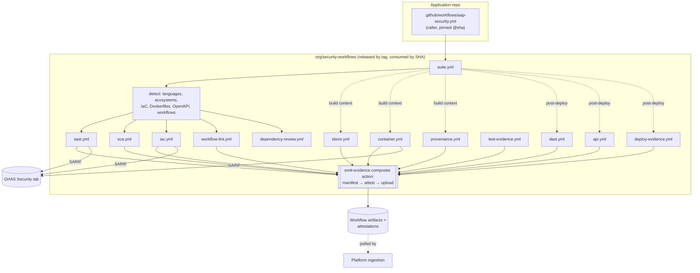

# 05 — Security Pipeline Architecture

| | |
|---|---|
| Status | DESIGNED. `security-workflows` repo not yet created (Stage 6). Existing reusable workflows in the earlier prototype scaffold are IMPLEMENTED (piloted on one repo). |
| Related | [ADR-006](../../adr/ADR-006-github-actions-security-pipeline.md), [ADR-028](../../adr/ADR-028-supply-chain-security.md), [ADR-030](../../adr/ADR-030-build-provenance-and-artifact-integrity.md), [Evidence model](04-evidence-model.md) |

## 1. Goals

1. **Paved road.** One caller file per repo. Capabilities are auto-detected. Sensible defaults per tier.
2. **Evidence by construction.** Every capability job emits a manifest and an attestation the platform can verify ([evidence model §4](04-evidence-model.md#4-producer-verification)).
3. **Tool-replaceable.** The platform reasons about *capabilities* (`scan.sast`), not products. Swapping a tool means changing one adapter job.
4. **The platform is never in the merge-critical path.** Gates use GitHub-native mechanisms (rulesets, required checks, code-scanning merge protection), so a platform outage never blocks delivery.
5. **No platform secrets in consumer repos.** The pull model ([ADR-005](../../adr/ADR-005-github-primary-source-integration.md)) fixes current-state issue CS-1.

## 2. Structure

## 3. Capabilities and default tools (all DESIGNED; tools are replaceable)

| Capability / evidence type | Default tool | Why this default | Runs on | Gate (when enabled) |
|---|---|---|---|---|
| SAST `scan.sast` | **CodeQL** (GHAS, already licensed). Advanced setup via `sast.yml`, *or* org-enabled default setup read from the API. | Licensed. Native PR annotations and merge protection. | PR, push to default, weekly | Code-scanning merge protection (ruleset) for new high/critical, Tier 1/2 |
| SCA `scan.sca` | **OSV-Scanner** (all lockfile ecosystems incl. Terraform via existing custom parser → SBOM) + Dependabot alerts via API | OSV covers malicious-package advisories (`MAL-*`). Vendor-neutral DB. | PR, push, weekly | — |
| Dependency gate | **`actions/dependency-review-action`** | Native. Blocks new vulnerable/denied-licence deps in the PR diff. | PR | Required check (ASC-BLD-07) |
| Malicious packages `scan.malicious_package` | OSV-Scanner (`MAL-*`) | As above | PR, push, **daily** (re-match) | Fail on any |
| Secrets `scan.secrets` | **GHAS secret scanning + push protection** (read via API, C3) | Licensed. Blocks at push time. No pipeline job needed. | Continuous | Push protection |
| IaC `scan.iac` | **Checkov** + **Trivy config** (PSRule optional for Bicep) | Checkov is already in use. Trivy also covers Dockerfiles and K8s. | PR, push | Tier-based, later |
| Container `scan.container` | **Trivy** (pinned by SHA, per the March 2026 incident) | Already piloted | On image build, weekly on deployed digests | Fail on fixable critical (Tier 1/2), later |
| SBOM `sbom` | **cdxgen** (source), **Syft** (images), existing Terraform lock-file parser | cdxgen is already piloted. Syft is strong for images. Both emit CycloneDX. | Build/release, push | — |
| Workflow hardening `scan.workflow_hardening` | **zizmor** + **actionlint** | Purpose-built GitHub Actions static analysis | PR, push | High findings, Tier 1–3 |
| Provenance `provenance.attestation` | **`actions/attest-build-provenance`** | Native, Sigstore-backed, SLSA provenance | Build/release | — |
| Security tests `test.security` | Team test framework → JUnit with `asvs`/`threat` properties | Reuses existing tests | PR, push | Test failure |
| DAST `scan.dast` | **OWASP ZAP** (baseline for T3, full + authenticated for T1/2) | Open source, scriptable auth | Post-deploy to test env, ≤ 90 days | — (findings → SLA) |
| API `scan.api` | **ZAP API scan** + **Schemathesis** (property-based, OpenAPI) | OWASP API Top 10 coverage (BOLA needs authZ test cases) | Post-deploy | — |
| Deploy record `deploy.record` | `gh attestation verify` + GitHub Deployments API | Binds digest → environment | CD | Fail on unverifiable digest (Tier 1) |
| Licence `scan.licence` | **Platform-side** evaluation of SBOM licences vs policy | Keeps policy central, no per-repo config | On SBOM ingest | — |

**Abstraction rule:** an adapter must produce (1) native output, (2) SARIF where the capability has code locations, (3) `evidence-manifest.json` conforming to the [schema](../../schemas/evidence/evidence-manifest.schema.json). Replacing a tool means a new adapter, plus a new trusted-producer entry, plus a parser in DefectDojo (most exist) or the platform. **No evaluator changes.**

## 4. Triggers

| Trigger | Jobs | Notes |
|---|---|---|
| `pull_request` | detect, sast, sca, dependency-review, iac, workflow-lint, test-evidence | Fast feedback (target < 10 min p90). Evidence is recorded as PR-scoped (does not satisfy default-branch controls). |
| `push` to default branch | detect, sast, sca, iac, workflow-lint, sbom (source), test-evidence | The evidence that satisfies controls |
| Build/release (caller passes `image`/`artifact` inputs) | sbom (artifact), container, provenance | Artifact-bound evidence |
| `deployment_status` / CD post-deploy | deploy-evidence, dast, api | Environment-bound |
| `schedule` (weekly, staggered by repo ID hash) | sast, sca, container (deployed digests) | Keeps `ceiling_days` freshness without code changes. Staggering avoids runner storms. |
| `workflow_dispatch` | all | Manual re-validation after remediation |

**Never used:** `pull_request_target`, `workflow_run` with checkout of untrusted refs (threat T-16).

## 5. Workflow security baseline (applies to `security-workflows` itself)

- Top-level `permissions: {}`. Each job declares the minimum (`contents: read`, `security-events: write` only for SARIF upload, `id-token: write` + `attestations: write` only in `emit-evidence`).
- **Every third-party action pinned by full commit SHA** with a version comment. Dependabot updates the pins. An org Actions allowlist restricts usable actions ([ADR-028](../../adr/ADR-028-supply-chain-security.md)).
- Tool binaries are downloaded by version with checksum verification. The checksum goes in the manifest (`tool.binary_sha256`).
- No secrets are required for default capabilities. Private registry pulls use OIDC (Azure/AWS federation), as the existing `image-scan.yml` does.
- `step-security/harden-runner` in audit mode to baseline egress, then block mode for Tier 1 repos. PROPOSED.
- **Public repositories:** job summaries and logs print counts only, never finding detail. Artifacts are kept 1 day (the platform pulls within minutes). SARIF goes to GHAS, which restricts alert visibility to users with security-alert access.
- **Fork PRs:** get a read-only token and no secrets. DAST/API never run for fork PRs. Fork-PR evidence never satisfies controls.

## 6. Release and pinning of `security-workflows`

1. Changes by PR. CODEOWNERS = AppSec platform team (2 approvals). Signed commits required.
2. CI on the workflows repo: actionlint, zizmor, and an end-to-end test against **canary repos** (one per major stack) asserting the manifests validate against the schema.
3. Release = annotated tag `vX.Y.Z` + GitHub release notes + **registration of the release commit SHA in `config/trusted-producers.yaml`** (PR to this repo).
4. Consumers pin by SHA (`@<sha> # vX.Y.Z`). Dependabot proposes bumps. The onboarding bot sets the initial pin.
5. A retired SHA stays trusted for 90 days after its successor's release. After that, evidence from it is rejected with `UNAPPROVED_WORKFLOW_REF`, and the control state shows a clear "pin outdated" reason.
6. Emergency revocation (e.g. a tool compromise) removes the SHA immediately and triggers evidence revocation for the affected window ([evidence model §5.3](04-evidence-model.md#53-derived-state)).

## 7. Migration from the existing reusable workflows

| Existing (the earlier prototype scaffold) | Target | Change |
|---|---|---|
| `sbom-scan.yml` (cdxgen/Terraform parser → DT upload with **repo-held DT key** → DD import with **repo-held DD key**) | `security-workflows/sbom.yml` | Keep the generation logic (the Terraform lock-file parser is valuable and already debugged). **Remove the DT/DD uploads.** The platform forwards SBOMs to Dependency-Track with its own credential after verification. |
| `image-scan.yml` (Trivy → SARIF → GHAS + DD with repo-held key) | `security-workflows/container.yml` | Keep the Trivy SHA pin and SARIF→GHAS. Remove the DD import (the platform forwards). Add the manifest. |
| `dependabot-import.yml` | **Retired.** The platform's GitHub connector reads Dependabot alerts directly with the GitHub App. | Removes a DD key from every repo |
| Repo secrets `DEFECTDOJO_API_KEY`, `DEPENDENCY_TRACK_API_KEY` | **Deleted and rotated** after migration | Closes CS-1 |

During migration both paths run. The platform's DefectDojo forwarding uses a different engagement naming scheme to prevent double-import.

## 8. Enforcement (so teams cannot quietly remove the pipeline)

| Mechanism | What it guarantees | Status |
|---|---|---|
| Org **ruleset "require workflows"**: `aap-security` must pass before merge on default branches of in-scope repos | The caller cannot be deleted or bypassed without an org-admin ruleset change, which is audited | Org ruleset: Team/Enterprise plan (decision D-018), applied by `examples/terraform/azure/envs/github`. Repository rulesets otherwise. |
| ASC-SRC-01 required checks | Detected even if the ruleset is changed | DESIGNED |
| ASC-SRC-02 CODEOWNERS on `.github/workflows/` | Workflow edits need owner review | DESIGNED |
| Freshness | A removed workflow produces `STALE` → `NO_EVIDENCE` within the ceiling window, which raises a control-gap finding | DESIGNED |

## 9. Gating roadmap (observe → gate)

| Stage | Gates enabled |
|---|---|
| Pilot (Phase 9) | Push protection (secrets), malicious packages. Everything else observe-only. |
| Rollout wave 1 (Tier 1/2) | + dependency review (new critical/high), + workflow-lint high, + code-scanning merge protection for new critical |
| Steady state | + container fixable critical (Tier 1/2), + IaC high (Tier 1). Gates per tier are configured in `suite.yml` inputs derived from the platform-provided tier. |

Every gate is a GitHub-native check. Overriding one uses the ruleset bypass list (audited), never a platform toggle.
