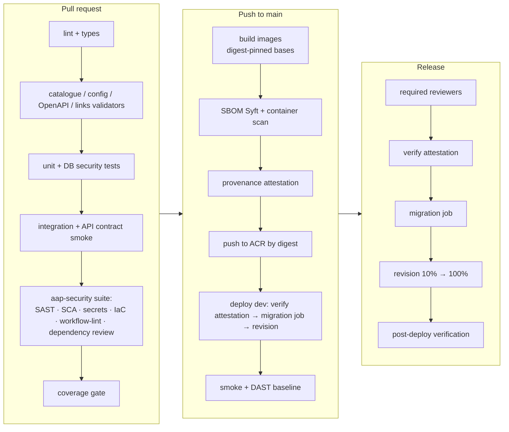

# 07 — Platform CI/CD (the platform as its own reference implementation)

| | |
|---|---|
| Status | Validation CI **IMPLEMENTED** in [`.github/workflows/ci.yml`](../../.github/workflows/ci.yml) (catalogue, metrics, config, schemas, OpenAPI, links, DB security tests; not yet run on GitHub because the directory is not a git repository). Build/deploy stages DESIGNED for Stage 7+. |
| Related | [ADR-028](../../adr/ADR-028-supply-chain-security.md), [ADR-030](../../adr/ADR-030-build-provenance-and-artifact-integrity.md), [Pipeline Security Standard](../standards/pipeline-security-standard.md), [Test strategy](../testing/test-strategy.md) |

The platform repository must demonstrate every control it promotes. It is registered as a **Tier 1** application and onboarded to the platform itself (E19-F04-S01).

## 1. Pipeline stages

## 2. Control mapping (the platform meets its own catalogue)

| Stage | Platform controls satisfied |
|---|---|
| Lint, types, validators | Catalogue integrity (E05) |
| SAST (CodeQL security-extended) | ASC-BLD-01 |
| SCA + malicious packages + dependency review | ASC-BLD-02, -07, -09 |
| Secret scanning + push protection | ASC-SRC-03, -04 |
| IaC scan of `infrastructure/` | ASC-BLD-04 |
| Workflow lint (zizmor, actionlint), SHA-pinned actions | ASC-SRC-06 |
| SBOM per image | ASC-BLD-03 |
| Container scan by digest | ASC-BLD-05 |
| Provenance attestation | ASC-BLD-06 |
| Protected `production` environment, OIDC to Azure | ASC-DEP-01, -02 |
| Attestation verification before deploy | ASC-DEP-03 |
| DAST baseline on dev; API contract tests | ASC-TST-01, -02 |
| Security regression tests tagged with ASVS IDs | ASC-TST-05 |

## 3. Post-deployment verification

Health and readiness · synthetic webhook (valid HMAC → 202; invalid → 401) · one API call per role (scope checks) · evaluator heartbeat (a canary app's control states re-evaluated within 5 min) · SLO burn-rate alerts watched for 30 min · automatic rollback on readiness failure.

## 4. Implemented now

The current [`ci.yml`](../../.github/workflows/ci.yml) runs: `tools/catalogue/validate.py --check`, `tools/metrics/render.py --check`, `tools/config/validate.py` (schemas, templates, config cross-references, OpenAPI incl. `x-permission` on every operation), `tools/docs/check_links.py`, and `tests/database/run.sh`. Actions are pinned by commit SHA (`actions/checkout` v7.0.1, `actions/setup-python` v7.0.0). The SHAs were resolved from the upstream tags on 2026-10-07. `permissions: {}` is set at the top level.
