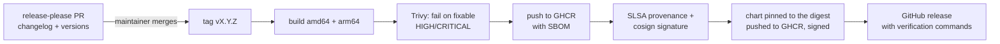

# 07 — Platform CI/CD (how FortProof itself is built and released)

| | |
|---|---|
| Status | IMPLEMENTED: [`ci.yml`](../../.github/workflows/ci.yml) runs on every pull request and push to `main`; [`release.yml`](../../.github/workflows/release.yml) publishes each release (first with artifacts: v0.1.3) |
| Related | [ADR-028](../../adr/ADR-028-supply-chain-security.md), [ADR-030](../../adr/ADR-030-build-provenance-and-artifact-integrity.md), [RELEASING.md](../../RELEASING.md), [Test strategy](../testing/test-strategy.md) |

The project builds, tests and signs what adopters run. It deploys nothing: there is no hosted FortProof. Adopters pull
the signed image and chart ([install](../install/helm.md)) or build from source.

## 1. Every pull request

`main` takes changes only through pull requests, merged by squash, with every required check passing on a branch
that is up to date with `main` (repository ruleset). Each commit carries a DCO sign-off.

| Check | What it does |
|---|---|
| Catalogue, config, schemas, OpenAPI, links | `tools/catalogue/validate.py --check`, `tools/metrics/render.py --check`, `tools/config/validate.py` (schemas, templates, cross-references, `x-permission` on every operation), generated reference pages up to date, `tools/docs/check_links.py`, shellcheck |
| Schema security-property tests | The database schema on PostgreSQL 16: ledgers cannot be changed, even by their owner; row-level security fails closed and keeps teams apart; a requester cannot approve their own exception; a finding closes only with verification evidence |
| Backend | ruff, mypy (strict on the domain and evaluators), unit and integration tests on PostgreSQL 16, the example plugin through its entry point, the licence gate, `pip-audit` on runtime dependencies |
| Frontend | Type check, build, `npm audit` on runtime dependencies |
| UI in a browser | Playwright against the real API and Content Security Policy: every page and role, WCAG 2.2 AA in both themes, keyboard paths, bundle-size budget |
| API contract | Schemathesis checks every implemented GET operation against the OpenAPI contract, on the demo world |
| Container image | Builds the image; checks it runs as non-root with a read-only root filesystem |
| Helm chart | Lint, kubeconform (Kubernetes 1.27 and 1.31), install and upgrade on kind |
| Shipped pipelines | Rendered, then actionlint and zizmor |
| Terraform | fmt, validate every root, Checkov |
| Secrets | gitleaks over the full history |
| Documentation site | `mkdocs build --strict` |
| DCO | Every commit signed off |
| CodeQL | `security-extended` on Python, TypeScript and the workflows |

Actions are pinned by commit SHA and base images by digest; every workflow starts from `permissions: {}`. Dependabot
proposes updates.

## 2. On a schedule

| Workflow | When | What |
|---|---|---|
| [`nightly.yml`](../../.github/workflows/nightly.yml) | Daily | Property-based fuzzing of every untrusted-input parser (5,000 examples each) |
| [`gitlab-live.yml`](../../.github/workflows/gitlab-live.yml) | Daily | GitLab CE end to end with a real runner |
| [`codeql.yml`](../../.github/workflows/codeql.yml) | Weekly, and on every change | Code scanning |
| [`scorecard.yml`](../../.github/workflows/scorecard.yml) | Weekly, and on pushes to `main` | OpenSSF Scorecard |
| [`docs.yml`](../../.github/workflows/docs.yml) | Pushes to `main` that touch the docs | Publishes [fortproof.dev](https://fortproof.dev) |

## 3. A release

Nothing is pushed before the scan passes. The procedure, including what to do when a release fails:
[RELEASING.md](../../RELEASING.md).

## 4. Controls the project meets itself

| Practice | Catalogue controls it corresponds to |
|---|---|
| CodeQL on every change | ASC-BLD-01 |
| `pip-audit`, `npm audit`, Dependabot | ASC-BLD-02, -07, -09 |
| gitleaks over the history, push protection | ASC-SRC-03, -04 |
| Checkov on the Terraform examples | ASC-BLD-04 |
| zizmor and actionlint, SHA-pinned actions | ASC-SRC-06 |
| SBOM with every image | ASC-BLD-03 |
| Image scan before publishing | ASC-BLD-05 |
| SLSA provenance and signatures on every release | ASC-BLD-06 |
| Security regression tests | ASC-TST-05 |

Not yet: FortProof does not yet run its own shipped security workflows on this repository or publish its own
assurance report from them (dogfooding, before 1.0: [ROADMAP](../../ROADMAP.md)).
