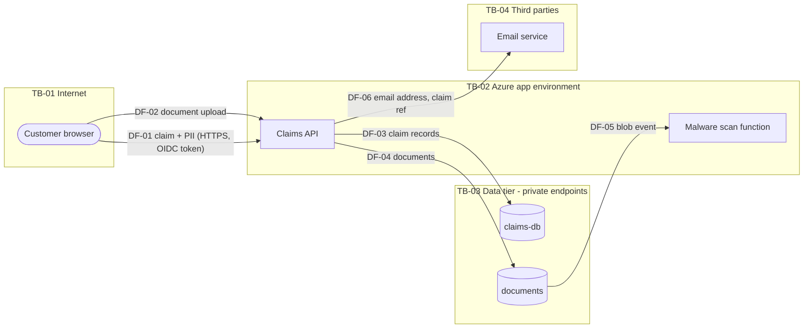

# Data flows: Claims API

> Each flow ID (DF-nn) and trust boundary (TB-nn) is defined in `assets.yaml`, and threats reference them.
> Trust boundaries are Mermaid subgraphs. Update this diagram in the same PR as any change that adds a
> flow, store or boundary, and label that PR `architecture-change` (this invalidates the threat-model review: ASC-TM-02).

