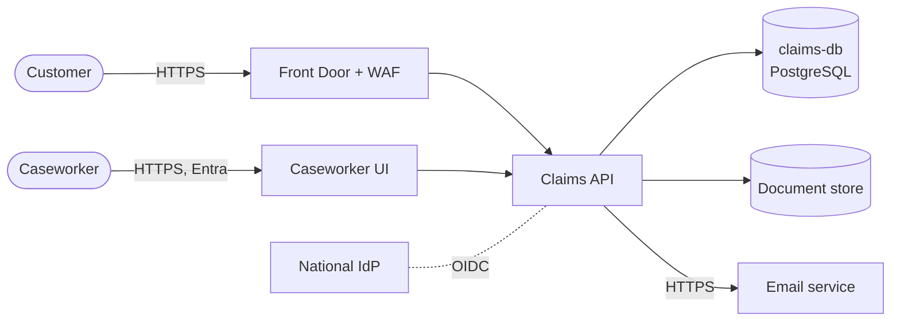

# System context: Claims API

> Template/example. Keep this file short: what the system does, who uses it, what it depends on.
> Review triggers: new external integration, new data store, new user population, exposure change.

## Purpose
Customers submit and track benefit claims. Caseworkers review claims in an internal UI.

## Actors
| Actor | Trust | Access path |
|---|---|---|
| Customer | Untrusted, authenticated via national IdP | Internet → Front Door (WAF) → Claims API |
| Caseworker | Trusted staff, Entra ID + MFA | Corporate network → internal UI → Claims API |
| Email service | Third-party service | Outbound HTTPS from Claims API |

## Context diagram

